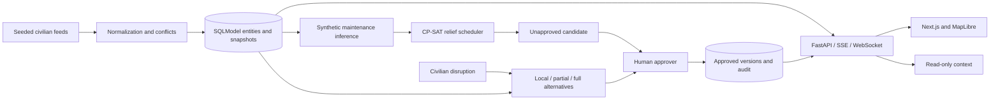

# Relief Atlas

Synthetic **civilian disaster-response decision support** for relief delivery, medical evacuation and rescue transport. The new `relief_platform` backend and `frontend` dashboard implement a civilian adaptation of the supplied problem statement. The original `civilian_sim` remains independently runnable.

All scenarios are fictional: **SYNTHETIC DATA – CIVILIAN ADVISORY ONLY**. The new platform never reads the military-themed root CSVs or `mock_ops.db`.

## Start the demo

Use Windows CPython 3.12 and Node.js 22 or newer:

```powershell
.\scripts\start-demo.ps1
```

The script installs dependencies, trains the synthetic maintenance model, seeds a scenario and starts the backend and dashboard. It prints three distinct role tokens. Open http://localhost:3000, select the matching role and enter its token. Tokens stay in page memory; the API enforces the token's actual role independently of the display selector. Process IDs and local log paths are printed for shutdown and troubleshooting.

Manual setup:

```powershell
py -3.12 -m venv .venv-cpython
.\.venv-cpython\Scripts\python.exe -m pip install -r requirements.txt
.\.venv-cpython\Scripts\python.exe -m relief_platform.cli seed
.\.venv-cpython\Scripts\python.exe -m uvicorn relief_platform.api:app --host 127.0.0.1 --port 8000
# In another terminal:
cd frontend
npm ci
npm run dev
```

Backend credentials appear in its console unless configured through `RELIEF_PLANNER_TOKEN`, `RELIEF_APPROVER_TOKEN` and `RELIEF_VIEWER_TOKEN`. Credentials must be distinct. SQLite scenarios and approved versions survive restart; randomly generated access tokens do not. API docs: http://localhost:8000/docs.

Load a preset or select the seeded scenario as a planner. Generate a candidate, then switch to approver credentials to approve it. A planner can propose a disruption; the approver selects a ranked option or rejects it. Proposing and rejecting leave scenario state unchanged. Approval atomically commits the reviewed option and increments the approved plan version. Another approval makes earlier proposals stale.

## Implemented capabilities

| Area | Civilian implementation |
|---|---|
| Persistence | Pydantic v2 requests; SQLModel entity, scenario, plan-version, proposal and audit tables; provenance fields; SQLite locally and PostgreSQL configuration |
| Scenarios | Seeded baseline, high tempo, degraded weather and many aircraft down presets; fictional civilian bases and resources |
| Fusion | Separate maintenance, crew, weather, airspace, priority and cache feeds; field allowlists; trust ranking then timestamp; equal-rank ambiguities block scheduling; freshness decay, conflicts and field provenance |
| Scheduling | OR-Tools CP-SAT: readiness/type compatibility, crew qualification/rest/duty, preparation/turnaround, time windows, departure weather closures, Shapely civilian airspace intersections, fuel/supply stock, runway/loading/ground capacity |
| Objective and reasons | Priority-weighted coverage, synthetic risk, fuel/time penalties, maximum crew-load fairness penalty, stability reward; selected reason codes and rejected candidate diagnostics |
| Predictions | Shared synthetic maintenance features; trained random forest; held-out ROC AUC and Brier scores; predictions enter solver risk penalties. Weather is a declared scenario risk score |
| Retasking | Four civilian disruption types; ranked local/fixed-commitment, partial-window and full-solve strategies; assignment diffs; human approve/reject; planner modification with fresh review; atomic version creation and stale checks |
| Copilot | Read-only plan, reasons, conflicts, KPI, previous-plan and audit context; record references; offline fallback; optional Gemini; SSE presentation; no state-changing tools |
| KPI | Measured planning/replanning latency, coverage, weighted coverage, assets used, crew-duty violations and changes/event; priority-ordered greedy comparison; benchmark script |
| API | FastAPI OpenAPI; background solver jobs; viewer/planner/approver bearer tokens; WebSocket notifications; state, source, approval, audit and benchmark endpoints |
| Dashboard | Next.js, TypeScript, Tailwind, MapLibre schematic map, aircraft/crew timeline, sources, explanations, disruptions, ranked proposal diff/review, audit filter/export, KPI comparison, readiness and shared copilot |
| Delivery | Docker Compose backend/frontend/PostgreSQL; environment configuration; seed/train/benchmark scripts; solver, fusion and API tests |

## Verification and measured reports

```powershell
.\.venv-cpython\Scripts\python.exe -m pytest relief_platform -q
.\.venv-cpython\Scripts\python.exe -m unittest discover -s civilian_sim -t . -p "test_*.py"
.\.venv-cpython\Scripts\python.exe -m relief_platform.cli train
.\.venv-cpython\Scripts\python.exe -m relief_platform.cli benchmark --scenarios 4
cd frontend
npm run typecheck
npm run build
```

Model, metrics, database and benchmark JSON are generated under `relief_platform/runtime` and ignored by Git. KPI numbers come from solver or benchmark executions; latency depends on the machine. Greedy comparisons do not measure human performance. Missing benchmark results return an explicit error instead of fabricated values.

## Docker

Copy `.env.example` to `.env`, replace the password and tokens, then run:

```powershell
docker compose up --build
docker compose exec backend python -m relief_platform.cli train
docker compose exec backend python -m relief_platform.cli benchmark
```

Load Docker scenarios through the UI/API. The local `seed` command creates SQLite data; Docker uses PostgreSQL. Use one backend process: background jobs and WebSocket subscribers are process-local. PostgreSQL is configured for Compose; the integration tests use SQLite.

## Architecture



## Data labels and practical limits

Provenance identifies source, timestamp, confidence and synthetic status. Feeds use the fixed simulation epoch of 14 October 2026, 08:00 UTC; freshness is relative to that epoch, not live weather. Map coordinates and straight routes are fictional.

This is a demonstration, not a production dispatch system. Flights return to origin. Time/capacity use 15-minute buckets. Rest, duty and fuel assumptions are simplified, not aviation regulations. Airspace avoidance delays a straight route until a closure ends; it does not find alternate routes. Fuel stock is conservatively charged the full flight fuel. The new platform does not simulate airborne dispatch or a running clock; the legacy simulator has its own separate lifecycle.

FEASIBLE status need not prove optimality. Candidate diagnostics are observed constraint failures or contention, not minimal infeasibility proofs. Local and partial strategies freeze commitments retained by a preliminary solve, not a guaranteed minimal repair; strategies may return identical results. Fairness penalizes maximum crew duty, without guaranteeing equality.

Fusion runs on scenario load. Report refresh never replays old feeds over approved disruptions. Arbitrary external ingest and a human conflict-resolution editor are not implemented. Confidence metadata is distinct from freshness. Prediction labels are generated; evaluation describes synthetic-data fit only. Weather is not a trained forecast. Cargo, support assets, slots, assignments and diffs are persisted alongside authoritative scenario/plan snapshots. Inventory constraints currently use base/task payloads.

Role tokens are demo access controls, not SSO or independently verified humans. Audit ORM changes are rejected and SQLite additionally has update/delete triggers. Database administrators can bypass controls; external tamper-proof anchoring, PostgreSQL audit triggers, migrations, external workers, audit pagination and provider-token streaming are not implemented. Gemini completes a response before SSE presentation. Setting `GEMINI_API_KEY` opts into sending synthetic read-only context to the provider. References do not guarantee model factual accuracy.

## What it does not do

No combat planning, military allocation, weapon employment, targeting, hostile tracking, threat evasion, tankers or aerial refuelling. No real aviation clearance, aircraft safety assurance, live mission dispatch or certified operational decisions. Legacy documentation and benchmark artifacts refer to that separate implementation.
